=== varde-change/FLOW.md ===
# varde-change flow

Generated for human readers; agents do not load this file. Regenerate
with `varde doc flow --write`. Dotted edges
are conditional loads; min tokens follow only solid edges. Thick edges
are hand-offs to a later stage, outside min and max. Double-bordered
nodes are skill modes run inline or agent dispatches. Min and max count
this skill; main adds modes the main agent runs inline, each file once.
Subagents are per dispatch (multiply by the dispatch count); * marks a
conditional dispatch. Module overview first, then one diagram per module.

## Files

- SKILL.md (~575 tok; routes: "What's in flight?", or an empty invocation — show curren..., Plan a new feature before building, Resume planning with no feature named, One task file assigned by an orchestrator (builder), A settled single-outcome refactor, A settled single-outcome change that fits one task, A named plan, multiple dependent outcomes, or unresolved..., Diagnose why something fails, without fixing it, Fix a named bug or regression, no mode given, Report evidence for finished work without changing anything, Run a group of related plans end to end, in dependency order)
  - references/build.md (~2275 tok; routes: A named plan, multiple dependent outcomes, or unresolved...)
    - references/build-execution.md (~1366 tok; routes: One task file assigned by an orchestrator (builder), A named plan, multiple dependent outcomes, or unresolved...)
    - references/build-finish.md (~1689 tok; routes: A named plan, multiple dependent outcomes, or unresolved..., Run a group of related plans end to end, in dependency order)
    - references/build-micro-change.md (~619 tok; routes: A settled single-outcome refactor, A settled single-outcome change that fits one task)
    - references/build-parallel.md (~645 tok; routes: Plan a new feature before building, Resume planning with no feature named, One task file assigned by an orchestrator (builder), A settled single-outcome refactor, A settled single-outcome change that fits one task, A named plan, multiple dependent outcomes, or unresolved..., Run a group of related plans end to end, in dependency order)
    - references/build-posture-debug.md (~989 tok; routes: One task file assigned by an orchestrator (builder), A named plan, multiple dependent outcomes, or unresolved..., Diagnose why something fails, without fixing it, Fix a named bug or regression, no mode given)
    - references/build-posture-refactor.md (~838 tok; routes: One task file assigned by an orchestrator (builder), A settled single-outcome refactor, A named plan, multiple dependent outcomes, or unresolved...)
    - references/build-recovery.md (~373 tok; routes: A named plan, multiple dependent outcomes, or unresolved...)
    - references/build-worktree.md (~1818 tok; routes: Plan a new feature before building, Resume planning with no feature named, One task file assigned by an orchestrator (builder), A settled single-outcome refactor, A settled single-outcome change that fits one task, A named plan, multiple dependent outcomes, or unresolved..., Run a group of related plans end to end, in dependency order)
  - references/orchestrate.md (~1758 tok; routes: Run a group of related plans end to end, in dependency order)
  - references/orchestration.md (~469 tok; routes: A named plan, multiple dependent outcomes, or unresolved...)
  - references/plan.md (~2806 tok; routes: Plan a new feature before building, Resume planning with no feature named)
    - references/plan-decomposition.md (~1039 tok; routes: Plan a new feature before building, Resume planning with no feature named, A named plan, multiple dependent outcomes, or unresolved...)
  - references/review-gate-plan.md (~538 tok; routes: "What's in flight?", or an empty invocation — show curren..., Plan a new feature before building, Resume planning with no feature named, A settled single-outcome refactor, A settled single-outcome change that fits one task, A named plan, multiple dependent outcomes, or unresolved..., Diagnose why something fails, without fixing it, Fix a named bug or regression, no mode given, Report evidence for finished work without changing anything, Run a group of related plans end to end, in dependency order)
  - references/review-gate-record.md (~544 tok; routes: -)
  - references/review-gate-worktree.md (~494 tok; routes: "What's in flight?", or an empty invocation — show curren..., Plan a new feature before building, Resume planning with no feature named, A settled single-outcome refactor, A settled single-outcome change that fits one task, A named plan, multiple dependent outcomes, or unresolved..., Diagnose why something fails, without fixing it, Fix a named bug or regression, no mode given, Report evidence for finished work without changing anything, Run a group of related plans end to end, in dependency order)
  - references/review-gates.md (~1550 tok; routes: "What's in flight?", or an empty invocation — show curren..., Plan a new feature before building, Resume planning with no feature named, A settled single-outcome refactor, A settled single-outcome change that fits one task, A named plan, multiple dependent outcomes, or unresolved..., Diagnose why something fails, without fixing it, Fix a named bug or regression, no mode given, Report evidence for finished work without changing anything, Run a group of related plans end to end, in dependency order)
  - references/status.md (~238 tok; routes: "What's in flight?", or an empty invocation — show curren...)
  - references/varde-code-cli.md (~53 tok; routes: Plan a new feature before building, Resume planning with no feature named, A named plan, multiple dependent outcomes, or unresolved...)
  - references/varde-workflow-cli.md (~219 tok; routes: "What's in flight?", or an empty invocation — show curren..., Plan a new feature before building, Resume planning with no feature named, One task file assigned by an orchestrator (builder), A settled single-outcome refactor, A settled single-outcome change that fits one task, A named plan, multiple dependent outcomes, or unresolved..., Diagnose why something fails, without fixing it, Fix a named bug or regression, no mode given, Report evidence for finished work without changing anything, Run a group of related plans end to end, in dependency order)
  - references/verify.md (~478 tok; routes: Report evidence for finished work without changing anything)
  - references/workflow-state.md (~238 tok; routes: "What's in flight?", or an empty invocation — show curren..., Plan a new feature before building, Resume planning with no feature named, One task file assigned by an orchestrator (builder), A settled single-outcome refactor, A settled single-outcome change that fits one task, A named plan, multiple dependent outcomes, or unresolved..., Diagnose why something fails, without fixing it, Fix a named bug or regression, no mode given, Report evidence for finished work without changing anything, Run a group of related plans end to end, in dependency order)

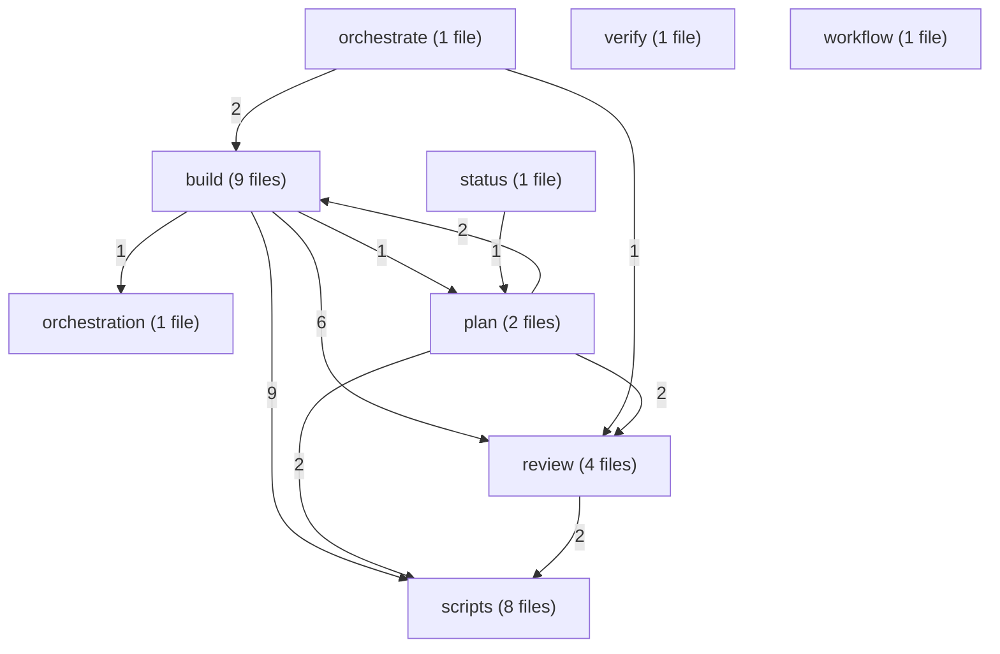

### build

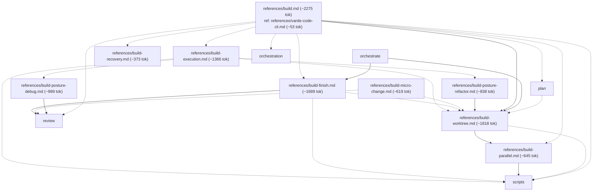

### orchestrate

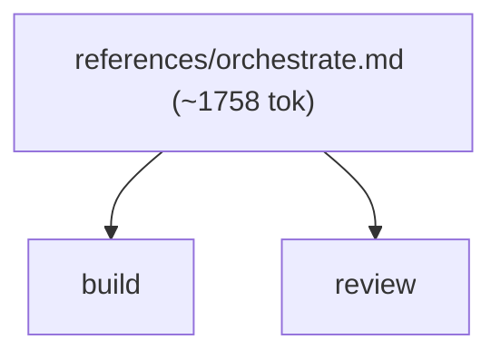

### orchestration

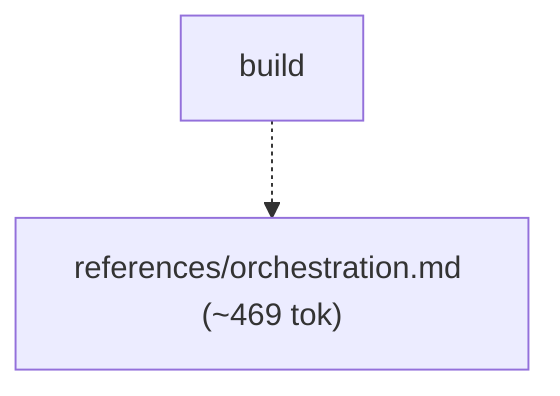

### plan

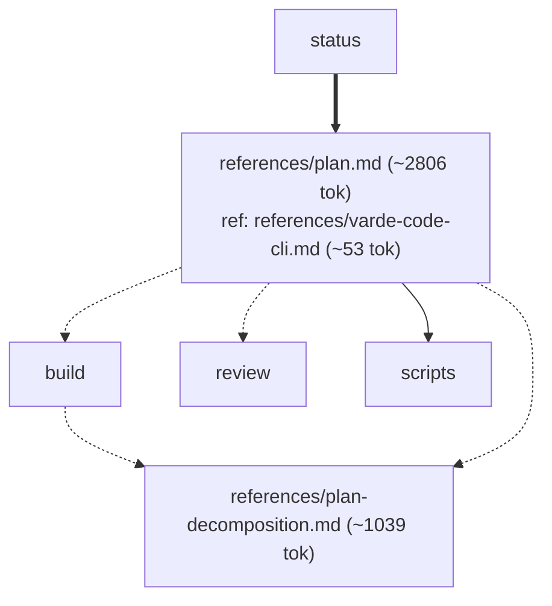

### review

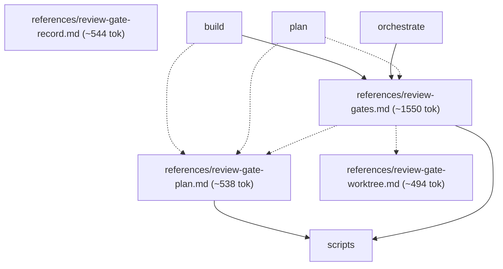

### scripts

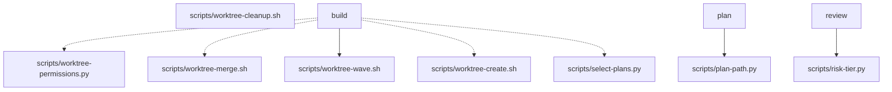

### status

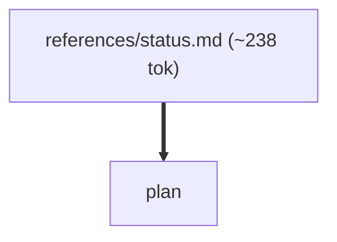

### verify

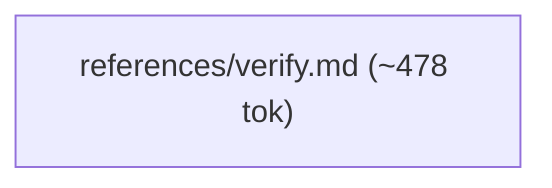

### workflow

## Routes

| Route | Min tokens | Max tokens | Main min | Main max | Subagents per dispatch | Lookups | Files |
|---|---|---|---|---|---|---|---|
| "What's in flight?", or an empty invocation — show curren... | ~813 | ~3852 | ~813 | ~3852 | review* ~2442-3474 | 0 | references/status.md, references/review-gates.md, references/varde-workflow-cli.md, references/workflow-state.md, references/review-gate-plan.md, references/review-gate-worktree.md, scripts/risk-tier.py |
| Plan a new feature before building | ~5844 | ~9975 | ~5844 | ~9975 | review* ~2442-3474 | 2 | references/plan.md, references/review-gates.md, references/varde-workflow-cli.md, references/workflow-state.md, scripts/plan-path.py, references/varde-code-cli.md, references/plan-decomposition.md, references/build-worktree.md, references/review-gate-plan.md, references/review-gate-worktree.md, scripts/risk-tier.py, references/build-parallel.md, scripts/worktree-create.sh, scripts/worktree-permissions.py, scripts/worktree-wave.sh |
| Resume planning with no feature named | ~5844 | ~9975 | ~5844 | ~9975 | review* ~2442-3474 | 2 | references/plan.md, references/review-gates.md, references/varde-workflow-cli.md, references/workflow-state.md, scripts/plan-path.py, references/varde-code-cli.md, references/plan-decomposition.md, references/build-worktree.md, references/review-gate-plan.md, references/review-gate-worktree.md, scripts/risk-tier.py, references/build-parallel.md, scripts/worktree-create.sh, scripts/worktree-permissions.py, scripts/worktree-wave.sh |
| One task file assigned by an orchestrator (builder) | ~1941 | ~6688 | ~1941 | ~6688 | - | 0 | references/build-execution.md, references/varde-workflow-cli.md, references/workflow-state.md, references/build-worktree.md, scripts/worktree-permissions.py, references/build-posture-debug.md, references/build-posture-refactor.md, references/build-parallel.md, scripts/worktree-create.sh, scripts/worktree-wave.sh |
| A settled single-outcome refactor | ~4495 | ~7534 | ~4495 | ~7534 | review* ~2442-3474 | 0 | references/build-micro-change.md, references/build-posture-refactor.md, references/review-gates.md, references/varde-workflow-cli.md, references/workflow-state.md, references/build-worktree.md, references/review-gate-plan.md, references/review-gate-worktree.md, scripts/risk-tier.py, references/build-parallel.md, scripts/worktree-create.sh, scripts/worktree-permissions.py, scripts/worktree-wave.sh |
| A settled single-outcome change that fits one task | ~3657 | ~6696 | ~3657 | ~6696 | review* ~2442-3474 | 0 | references/build-micro-change.md, references/review-gates.md, references/varde-workflow-cli.md, references/workflow-state.md, references/build-worktree.md, references/review-gate-plan.md, references/review-gate-worktree.md, scripts/risk-tier.py, references/build-parallel.md, scripts/worktree-create.sh, scripts/worktree-permissions.py, scripts/worktree-wave.sh |
| A named plan, multiple dependent outcomes, or unresolved... | ~5313 | ~15168 | ~5313 | ~15168 | review* ~2442-3474, builder ~3111-7858 | 1 | references/build.md, references/review-gates.md, references/varde-workflow-cli.md, references/workflow-state.md, references/review-gate-plan.md, references/varde-code-cli.md, references/build-worktree.md, references/plan-decomposition.md, references/build-execution.md, references/build-recovery.md, references/build-finish.md, scripts/select-plans.py, references/orchestration.md, references/build-parallel.md, references/review-gate-worktree.md, scripts/risk-tier.py, scripts/worktree-create.sh, scripts/worktree-permissions.py, references/build-posture-debug.md, references/build-posture-refactor.md, scripts/worktree-merge.sh, scripts/worktree-wave.sh |
| Diagnose why something fails, without fixing it | ~3114 | ~4603 | ~3114 | ~4603 | review ~2442-3474 | 0 | references/build-posture-debug.md, references/review-gates.md, references/varde-workflow-cli.md, references/workflow-state.md, references/review-gate-plan.md, references/review-gate-worktree.md, scripts/risk-tier.py |
| Fix a named bug or regression, no mode given | ~3114 | ~4603 | ~3114 | ~4603 | review ~2442-3474 | 0 | references/build-posture-debug.md, references/review-gates.md, references/varde-workflow-cli.md, references/workflow-state.md, references/review-gate-plan.md, references/review-gate-worktree.md, scripts/risk-tier.py |
| Report evidence for finished work without changing anything | ~1053 | ~4092 | ~1053 | ~4092 | review* ~2442-3474 | 0 | references/verify.md, references/review-gates.md, references/varde-workflow-cli.md, references/workflow-state.md, references/review-gate-plan.md, references/review-gate-worktree.md, scripts/risk-tier.py |
| Run a group of related plans end to end, in dependency order | ~8035 | ~9524 | ~10310 | ~16926 | review ~2442-3474, builder ~3111-7858 | 0 | references/orchestrate.md, references/review-gates.md, references/varde-workflow-cli.md, references/workflow-state.md, references/build-worktree.md, references/build-finish.md, references/review-gate-plan.md, references/review-gate-worktree.md, scripts/risk-tier.py, references/build-parallel.md, scripts/worktree-create.sh, scripts/worktree-permissions.py, scripts/worktree-merge.sh, scripts/worktree-wave.sh |

## Structure

| Measure | Value | Target | Status |
|---|---|---|---|
| Mutual links | 0 | 0 | ok |
| Max links out of one file | 11 (references/build.md) | < 6 | warning |
| Average links per linking file | 3.08 (40 links, 13 files) | <= 2 | warning |
| Cross-module edges | 25 | - | - |
| Diagram edges | 88 | <= 60 | warning |
| Max route cyclomatic | 29 | <= 10 | warning |
| Max route cognitive | 68 | <= 10 warn, <= 15 error | defect |
| Most files reached by one route | 22 (A named plan, multiple dependent outcomes, or unresolved...) | <= 15 | warning |

- fan-out: references/build.md (11 links out, target < 6)
- fan-out: references/plan.md (6 links out, target < 6)
- density: average 3.08 links per linking file (target <= 2)

## Findings

- single caller: references/build-recovery.md <- references/build.md
- single caller: references/build.md <- SKILL.md: A named plan, multiple dependent outcomes, or unresolved...
- single caller: references/orchestrate.md <- SKILL.md: Run a group of related plans end to end, in dependency order
- single caller: references/orchestration.md <- references/build.md
- single caller: references/status.md <- SKILL.md: "What's in flight?", or an empty invocation — show curren...
- single caller: references/verify.md <- SKILL.md: Report evidence for finished work without changing anything
- single caller: references/workflow-state.md <- SKILL.md: Gotchas
- shared: references/build-execution.md <- SKILL.md: One task file assigned by an orchestrator (builder); references/build.md
- shared: references/build-finish.md <- references/build.md; references/orchestrate.md
- shared: references/build-micro-change.md <- SKILL.md: A settled single-outcome change that fits one task; SKILL.md: A settled single-outcome refactor
- shared: references/build-parallel.md <- references/build-worktree.md; references/build.md
- shared: references/build-posture-debug.md <- SKILL.md: Diagnose why something fails, without fixing it; SKILL.md: Fix a named bug or regression, no mode given; references/build-execution.md
- shared: references/build-posture-refactor.md <- SKILL.md: A settled single-outcome refactor; references/build-execution.md
- shared: references/build-worktree.md <- references/build-execution.md; references/build-finish.md; references/build-micro-change.md; references/build-posture-refactor.md; references/build.md; references/orchestrate.md; references/plan.md
- shared: references/plan-decomposition.md <- references/build.md; references/plan.md
- shared: references/plan.md <- SKILL.md: Plan a new feature before building; SKILL.md: Resume planning with no feature named; references/status.md
=== varde-docs/FLOW.md ===
# varde-docs flow

Generated for human readers; agents do not load this file. Regenerate
with `varde doc flow --write`. Dotted edges
are conditional loads; min tokens follow only solid edges. Thick edges
are hand-offs to a later stage, outside min and max. Double-bordered
nodes are skill modes run inline or agent dispatches. Min and max count
this skill; main adds modes the main agent runs inline, each file once.
Subagents are per dispatch (multiply by the dispatch count); * marks a
conditional dispatch. Module overview first, then one diagram per module.

## Files

- SKILL.md (~226 tok; routes: User-facing: README.md, docs/*.md, CHANGELOGs, release no..., A generated domain specification under <knowledge>/specs/...)
  - references/refresh.md (~456 tok; routes: User-facing: README.md, docs/*.md, CHANGELOGs, release no...)
  - references/review-gate-plan.md (~538 tok; routes: User-facing: README.md, docs/*.md, CHANGELOGs, release no..., A generated domain specification under <knowledge>/specs/...)
  - references/review-gate-record.md (~544 tok; routes: -)
  - references/review-gate-worktree.md (~494 tok; routes: User-facing: README.md, docs/*.md, CHANGELOGs, release no..., A generated domain specification under <knowledge>/specs/...)
  - references/review-gates.md (~1550 tok; routes: User-facing: README.md, docs/*.md, CHANGELOGs, release no..., A generated domain specification under <knowledge>/specs/...)
  - references/spec.md (~1435 tok; routes: A generated domain specification under <knowledge>/specs/...)
    - references/spec-format.md (~817 tok; routes: A generated domain specification under <knowledge>/specs/...)
  - references/varde-code-cli.md (~53 tok; routes: User-facing: README.md, docs/*.md, CHANGELOGs, release no..., A generated domain specification under <knowledge>/specs/...)

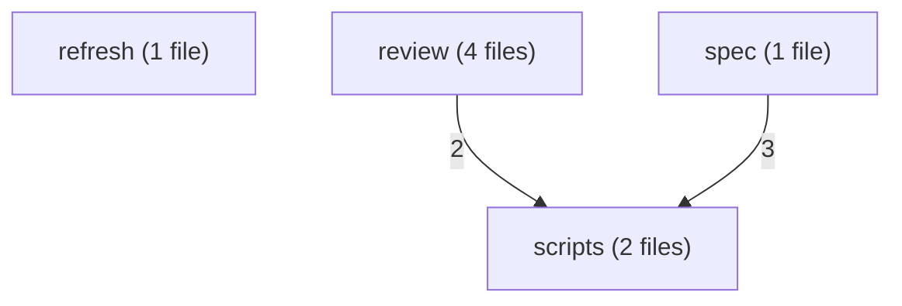

### refresh

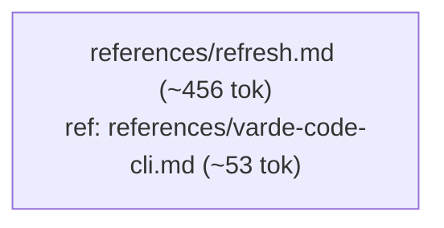

### review

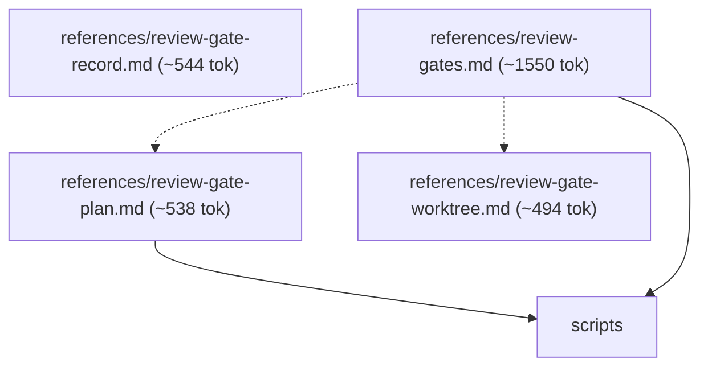

### scripts

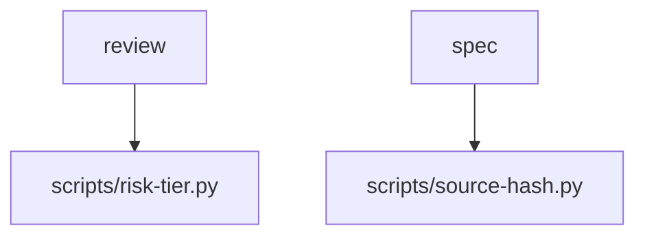

### spec

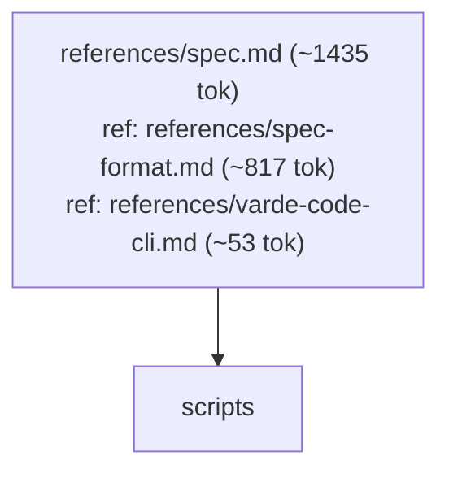

## Routes

| Route | Min tokens | Max tokens | Main min | Main max | Subagents per dispatch | Lookups | Files |
|---|---|---|---|---|---|---|---|
| User-facing: README.md, docs/*.md, CHANGELOGs, release no... | ~682 | ~3317 | ~682 | ~3317 | review* ~2442-3474 | 1 | references/refresh.md, references/review-gates.md, references/varde-code-cli.md, references/review-gate-plan.md, references/review-gate-worktree.md, scripts/risk-tier.py |
| A generated domain specification under <knowledge>/specs/... | ~2531 | ~5113 | ~2531 | ~5113 | builder ~3111-7858, review* ~2442-3474 | 1 | references/spec.md, references/review-gates.md, references/spec-format.md, references/varde-code-cli.md, references/review-gate-plan.md, references/review-gate-worktree.md, scripts/risk-tier.py, scripts/source-hash.py |

## Structure

| Measure | Value | Target | Status |
|---|---|---|---|
| Mutual links | 0 | 0 | ok |
| Max links out of one file | 3 (references/review-gates.md) | < 6 | ok |
| Average links per linking file | 1.6 (8 links, 5 files) | <= 2 | ok |
| Cross-module edges | 5 | - | - |
| Diagram edges | 18 | <= 60 | ok |
| Max route cyclomatic | 4 | <= 10 | ok |
| Max route cognitive | 7 | <= 10 warn, <= 15 error | ok |
| Most files reached by one route | 8 (A generated domain specification under <knowledge>/specs/...) | <= 15 | ok |

## Findings

- chain: references/spec-format.md <- references/spec.md
- single caller: references/refresh.md <- SKILL.md: User-facing: README.md, docs/*.md, CHANGELOGs, release no...
- single caller: references/spec.md <- SKILL.md: A generated domain specification under <knowledge>/specs/...
=== varde-flow-gaps/FLOW.md ===
# varde-flow-gaps flow

Generated for human readers; agents do not load this file. Regenerate
with `varde doc flow --write`. Dotted edges
are conditional loads; min tokens follow only solid edges. Thick edges
are hand-offs to a later stage, outside min and max. Double-bordered
nodes are skill modes run inline or agent dispatches. Min and max count
this skill; main adds modes the main agent runs inline, each file once.
Subagents are per dispatch (multiply by the dispatch count); * marks a
conditional dispatch. Module overview first, then one diagram per module.

## Files

- SKILL.md (~57 tok; routes: Plan the work, Check the work)
  - references/alpha.md (~24 tok; routes: Plan the work, Check the work)
  - references/beta.md (~16 tok; routes: Plan the work, Check the work)
  - references/orphan.md (~8 tok; routes: -)

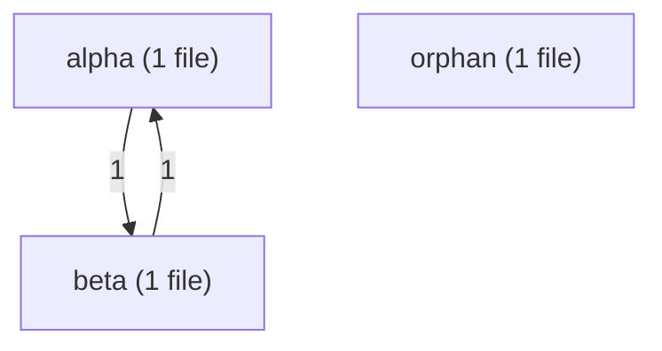

### alpha

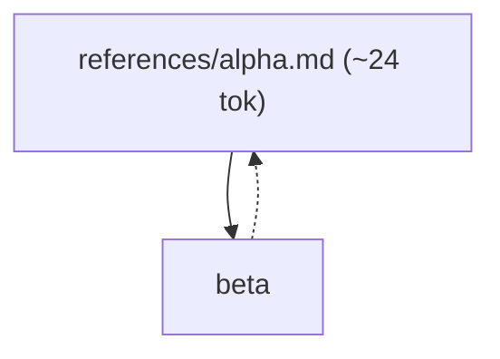

### beta

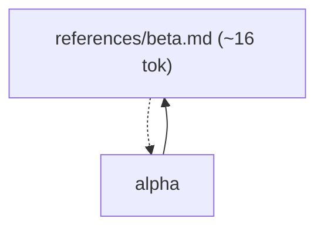

### orphan

## Routes

| Route | Min tokens | Max tokens | Main min | Main max | Subagents per dispatch | Lookups | Files |
|---|---|---|---|---|---|---|---|
| Plan the work | ~97 | ~97 | ~97 | ~97 | - | 0 | references/alpha.md, references/beta.md |
| Check the work | ~73 | ~97 | ~73 | ~97 | - | 0 | references/beta.md, references/alpha.md |

## Structure

| Measure | Value | Target | Status |
|---|---|---|---|
| Mutual links | 1 | 0 | defect |
| Max links out of one file | 1 (references/beta.md) | < 6 | ok |
| Average links per linking file | 1.0 (2 links, 2 files) | <= 2 | ok |
| Cross-module edges | 2 | - | - |
| Diagram edges | 4 | <= 60 | ok |
| Max route cyclomatic | 2 | <= 10 | ok |
| Max route cognitive | 3 | <= 10 warn, <= 15 error | ok |
| Most files reached by one route | 2 (Plan the work) | <= 15 | ok |

- cycle: references/alpha.md <-> references/beta.md

## Findings

- shared: references/alpha.md <- SKILL.md: Plan the work; references/beta.md
- shared: references/beta.md <- SKILL.md: Check the work; references/alpha.md
- unreferenced: references/orphan.md
- missing: references/alpha.md:3 -> references/ghost.md
