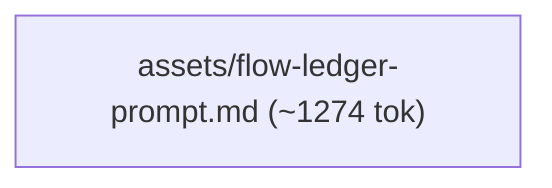
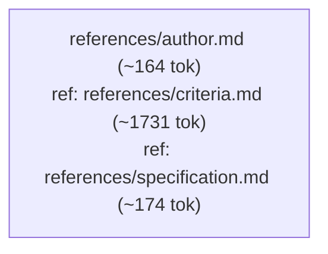
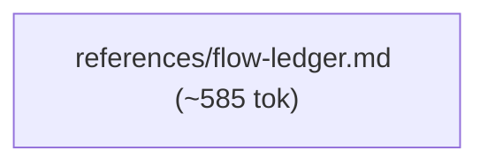
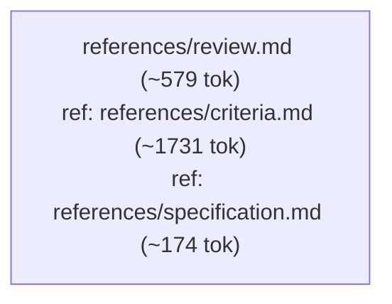

# varde-agent-doc-authoring flow

Generated for human readers; agents do not load this file. Regenerate
with `varde doc flow --write`. Dotted edges
are conditional loads; min tokens follow only solid edges. Thick edges
are hand-offs to a later stage, outside min and max. Double-bordered
nodes are skill modes run inline or agent dispatches. Min and max count
this skill; main adds modes the main agent runs inline, each file once.
Subagents are per dispatch (multiply by the dispatch count); * marks a
conditional dispatch. Module overview first, then one diagram per module.

## Files

- SKILL.md (~289 tok; routes: Author or revise a skill or agent document, Review a skill or agent document, Score or audit a skill's full-flow complexity, Improve triggering)
  - references/author.md (~164 tok; routes: Author or revise a skill or agent document)
  - references/criteria.md (~1731 tok; routes: Author or revise a skill or agent document, Review a skill or agent document)
  - references/flow-ledger.md (~585 tok; routes: Score or audit a skill's full-flow complexity)
  - references/review.md (~579 tok; routes: Review a skill or agent document)
    - references/review-gates.md (~438 tok; routes: -)
  - references/specification.md (~174 tok; routes: Author or revise a skill or agent document, Review a skill or agent document, Improve triggering)

### assets

### author

### flow

### review

## Routes

| Route | Min tokens | Max tokens | Main min | Main max | Subagents per dispatch | Lookups | Files |
|---|---|---|---|---|---|---|---|
| Author or revise a skill or agent document | ~2358 | ~2358 | ~2358 | ~2358 | - | 0 | references/author.md, references/criteria.md, references/specification.md |
| Review a skill or agent document | ~2599 | ~2773 | ~2599 | ~2773 | review* ~1684 | 2 | references/review.md, references/criteria.md, references/specification.md |
| Score or audit a skill's full-flow complexity | ~874 | ~874 | ~874 | ~874 | - | 0 | references/flow-ledger.md |
| Improve triggering | ~463 | ~463 | ~463 | ~463 | - | 0 | references/specification.md |

## Structure

| Measure | Value | Target | Status |
|---|---|---|---|
| Mutual links | 0 | 0 | ok |
| Max links out of one file | 2 (references/review.md) | < 6 | ok |
| Average links per linking file | 2.0 (4 links, 2 files) | <= 2 | ok |
| Cross-module edges | 4 | - | - |
| Diagram edges | 12 | <= 60 | ok |
| Max route cyclomatic | 1 | <= 10 | ok |
| Max route cognitive | 0 | <= 10 warn, <= 15 error | ok |
| Most files reached by one route | 3 (Author or revise a skill or agent document) | <= 15 | ok |

## Findings

- single caller: references/author.md <- SKILL.md: Author or revise a skill or agent document
- single caller: references/flow-ledger.md <- SKILL.md: Score or audit a skill's full-flow complexity
- single caller: references/review.md <- SKILL.md: Review a skill or agent document
- shared: references/criteria.md <- references/author.md; references/review.md
- shared: references/specification.md <- SKILL.md: Improve triggering; references/author.md; references/review.md
