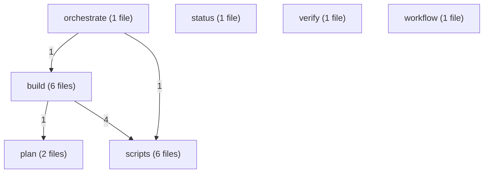
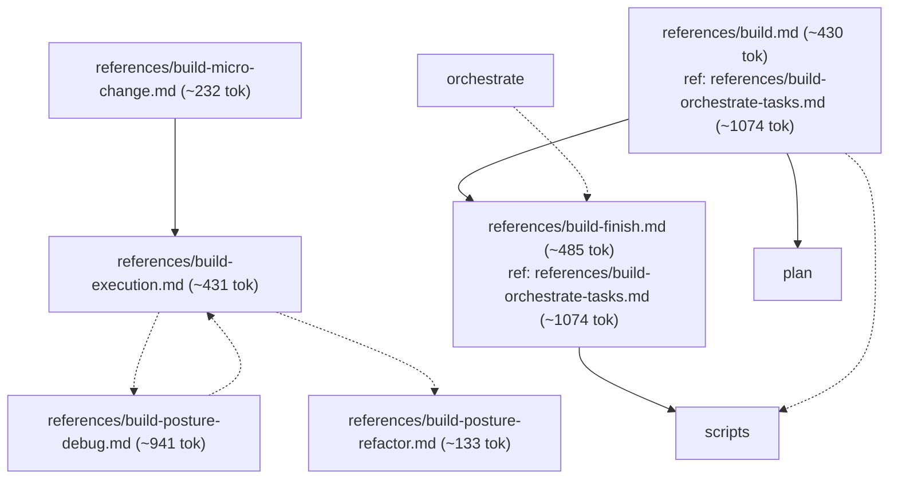
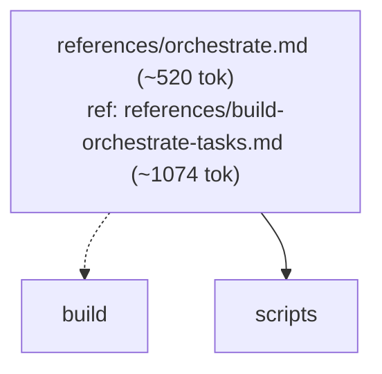
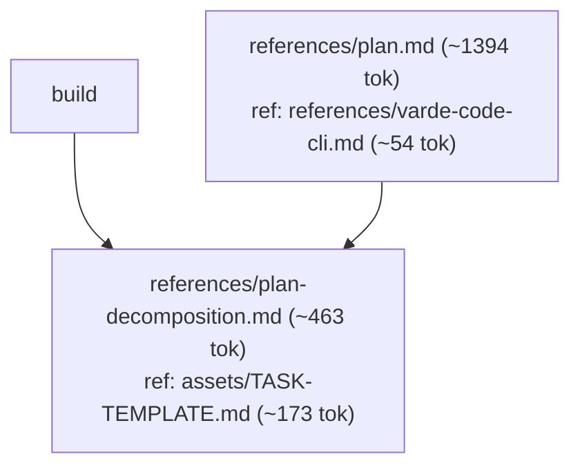
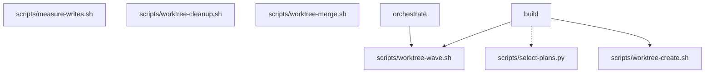
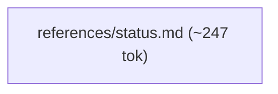
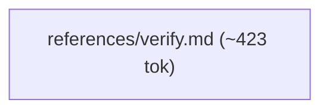
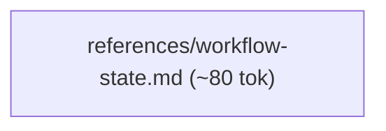

# varde-change flow

Generated for human readers; agents do not load this file. Regenerate
with `varde doc flow --write`. Dotted edges
are conditional loads; min tokens follow only solid edges. Thick edges
are hand-offs to a later stage, outside min and max. Double-bordered
nodes are skill modes run inline or agent dispatches. Min and max count
this skill; main adds modes the main agent runs inline, each file once.
Subagents are per dispatch (multiply by the dispatch count); * marks a
conditional dispatch. Module overview first, then one diagram per module.

## Files

- SKILL.md (~614 tok; routes: "What's in flight?", or an empty invocation — show curren..., Plan a new feature before building, Resume planning with no feature named, One task file assigned by an orchestrator (builder), A settled single-outcome refactor, A settled single-outcome change that fits one task, A named plan, multiple dependent outcomes, or unresolved..., Diagnose why something fails, without fixing it, Fix a named bug or regression, no mode given, Report evidence for finished work without changing anything, Run a plan set's ready plans in parallel)
  - references/build.md (~430 tok; routes: A named plan, multiple dependent outcomes, or unresolved...)
    - references/build-execution.md (~431 tok; routes: One task file assigned by an orchestrator (builder), A settled single-outcome refactor, A settled single-outcome change that fits one task, Diagnose why something fails, without fixing it, Fix a named bug or regression, no mode given)
    - references/build-finish.md (~485 tok; routes: A named plan, multiple dependent outcomes, or unresolved..., Run a plan set's ready plans in parallel)
    - references/build-micro-change.md (~232 tok; routes: A settled single-outcome refactor, A settled single-outcome change that fits one task)
    - references/build-orchestrate-tasks.md (~1074 tok; routes: A named plan, multiple dependent outcomes, or unresolved..., Run a plan set's ready plans in parallel)
    - references/build-posture-debug.md (~941 tok; routes: One task file assigned by an orchestrator (builder), A settled single-outcome refactor, A settled single-outcome change that fits one task, Diagnose why something fails, without fixing it, Fix a named bug or regression, no mode given)
    - references/build-posture-refactor.md (~133 tok; routes: One task file assigned by an orchestrator (builder), A settled single-outcome refactor, A settled single-outcome change that fits one task, Diagnose why something fails, without fixing it, Fix a named bug or regression, no mode given)
  - references/orchestrate.md (~520 tok; routes: Run a plan set's ready plans in parallel)
  - references/plan.md (~1394 tok; routes: Plan a new feature before building, Resume planning with no feature named)
    - references/plan-decomposition.md (~463 tok; routes: Plan a new feature before building, Resume planning with no feature named, A named plan, multiple dependent outcomes, or unresolved...)
  - references/review-gates.md (~438 tok; routes: -)
  - references/status.md (~247 tok; routes: "What's in flight?", or an empty invocation — show curren...)
  - references/varde-code-cli.md (~54 tok; routes: Plan a new feature before building, Resume planning with no feature named)
  - references/varde-workflow-cli.md (~213 tok; routes: "What's in flight?", or an empty invocation — show curren..., Plan a new feature before building, Resume planning with no feature named, One task file assigned by an orchestrator (builder), A settled single-outcome refactor, A settled single-outcome change that fits one task, A named plan, multiple dependent outcomes, or unresolved..., Diagnose why something fails, without fixing it, Fix a named bug or regression, no mode given, Report evidence for finished work without changing anything, Run a plan set's ready plans in parallel)
  - references/verify.md (~423 tok; routes: Report evidence for finished work without changing anything)
  - references/workflow-state.md (~80 tok; routes: "What's in flight?", or an empty invocation — show curren..., Plan a new feature before building, Resume planning with no feature named, One task file assigned by an orchestrator (builder), A settled single-outcome refactor, A settled single-outcome change that fits one task, A named plan, multiple dependent outcomes, or unresolved..., Diagnose why something fails, without fixing it, Fix a named bug or regression, no mode given, Report evidence for finished work without changing anything, Run a plan set's ready plans in parallel)

### build

### orchestrate

### plan

### scripts

### status

### verify

### workflow

## Routes

| Route | Min tokens | Max tokens | Main min | Main max | Subagents per dispatch | Lookups | Files |
|---|---|---|---|---|---|---|---|
| "What's in flight?", or an empty invocation — show curren... | ~861 | ~1154 | ~861 | ~1154 | - | 0 | references/status.md, references/varde-workflow-cli.md, references/workflow-state.md |
| Plan a new feature before building | ~2698 | ~2991 | ~2698 | ~2991 | - | 0 | references/plan.md, references/varde-workflow-cli.md, references/workflow-state.md, references/varde-code-cli.md, references/plan-decomposition.md, assets/TASK-TEMPLATE.md |
| Resume planning with no feature named | ~2698 | ~2991 | ~2698 | ~2991 | - | 0 | references/plan.md, references/varde-workflow-cli.md, references/workflow-state.md, references/varde-code-cli.md, references/plan-decomposition.md, assets/TASK-TEMPLATE.md |
| One task file assigned by an orchestrator (builder) | ~1045 | ~2412 | ~1045 | ~2412 | - | 0 | references/build-execution.md, references/varde-workflow-cli.md, references/workflow-state.md, references/build-posture-debug.md, references/build-posture-refactor.md |
| A settled single-outcome refactor | ~1410 | ~2644 | ~1410 | ~2644 | - | 0 | references/build-micro-change.md, references/build-posture-refactor.md, references/varde-workflow-cli.md, references/workflow-state.md, references/build-execution.md, references/build-posture-debug.md |
| A settled single-outcome change that fits one task | ~1277 | ~2644 | ~1277 | ~2644 | - | 0 | references/build-micro-change.md, references/varde-workflow-cli.md, references/workflow-state.md, references/build-execution.md, references/build-posture-debug.md, references/build-posture-refactor.md |
| A named plan, multiple dependent outcomes, or unresolved... | ~3239 | ~3532 | ~3239 | ~3532 | review ~1684 | 1 | references/build.md, references/build-orchestrate-tasks.md, references/varde-workflow-cli.md, references/workflow-state.md, scripts/select-plans.py, scripts/worktree-create.sh, references/build-finish.md, references/plan-decomposition.md, scripts/worktree-wave.sh, assets/TASK-TEMPLATE.md |
| Diagnose why something fails, without fixing it | ~1555 | ~2412 | ~1555 | ~2412 | - | 0 | references/build-posture-debug.md, references/varde-workflow-cli.md, references/workflow-state.md, references/build-execution.md, references/build-posture-refactor.md |
| Fix a named bug or regression, no mode given | ~1555 | ~2412 | ~1555 | ~2412 | - | 0 | references/build-posture-debug.md, references/varde-workflow-cli.md, references/workflow-state.md, references/build-execution.md, references/build-posture-refactor.md |
| Report evidence for finished work without changing anything | ~1037 | ~1330 | ~1037 | ~1330 | - | 0 | references/verify.md, references/varde-workflow-cli.md, references/workflow-state.md |
| Run a plan set's ready plans in parallel | ~2208 | ~2986 | ~2208 | ~2986 | review ~1684 | 1 | references/orchestrate.md, references/varde-workflow-cli.md, references/workflow-state.md, references/build-orchestrate-tasks.md, references/build-finish.md, scripts/worktree-wave.sh |

## Structure

| Measure | Value | Target | Status |
|---|---|---|---|
| Mutual links | 1 | 0 | defect |
| Max links out of one file | 5 (references/build.md) | < 6 | ok |
| Average links per linking file | 1.78 (16 links, 9 files) | <= 2 | ok |
| Cross-module edges | 8 | - | - |
| Diagram edges | 41 | <= 60 | ok |
| Max route cyclomatic | 5 | <= 10 | ok |
| Max route cognitive | 12 | <= 10 warn, <= 15 error | warning |
| Most files reached by one route | 10 (A named plan, multiple dependent outcomes, or unresolved...) | <= 15 | ok |

- cycle: references/build-execution.md <-> references/build-posture-debug.md

## Findings

- single caller: references/build.md <- SKILL.md: A named plan, multiple dependent outcomes, or unresolved...
- single caller: references/orchestrate.md <- SKILL.md: Run a plan set's ready plans in parallel
- single caller: references/status.md <- SKILL.md: "What's in flight?", or an empty invocation — show curren...
- single caller: references/verify.md <- SKILL.md: Report evidence for finished work without changing anything
- single caller: references/workflow-state.md <- SKILL.md: Gotchas
- shared: references/build-execution.md <- SKILL.md: One task file assigned by an orchestrator (builder); references/build-micro-change.md; references/build-posture-debug.md
- shared: references/build-finish.md <- references/build.md; references/orchestrate.md
- shared: references/build-micro-change.md <- SKILL.md: A settled single-outcome change that fits one task; SKILL.md: A settled single-outcome refactor
- shared: references/build-orchestrate-tasks.md <- SKILL.md: A named plan, multiple dependent outcomes, or unresolved...; references/build-finish.md; references/build.md; references/orchestrate.md
- shared: references/build-posture-debug.md <- SKILL.md: Diagnose why something fails, without fixing it; SKILL.md: Fix a named bug or regression, no mode given; references/build-execution.md
- shared: references/build-posture-refactor.md <- SKILL.md: A settled single-outcome refactor; references/build-execution.md
- shared: references/plan-decomposition.md <- references/build.md; references/plan.md
- shared: references/plan.md <- SKILL.md: Plan a new feature before building; SKILL.md: Resume planning with no feature named
- unreferenced: scripts/worktree-cleanup.sh
- unreferenced: scripts/worktree-merge.sh
