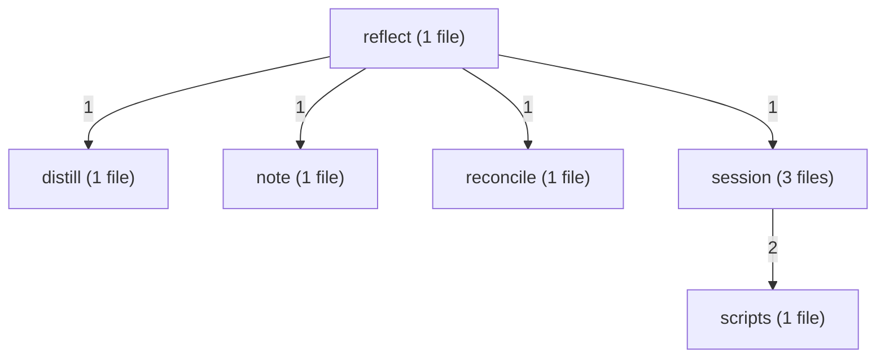
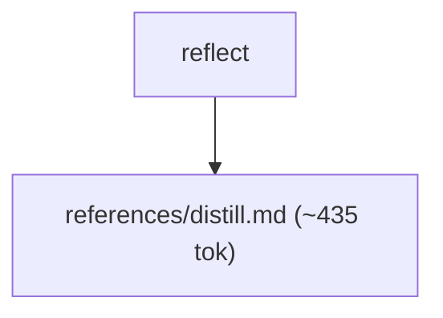
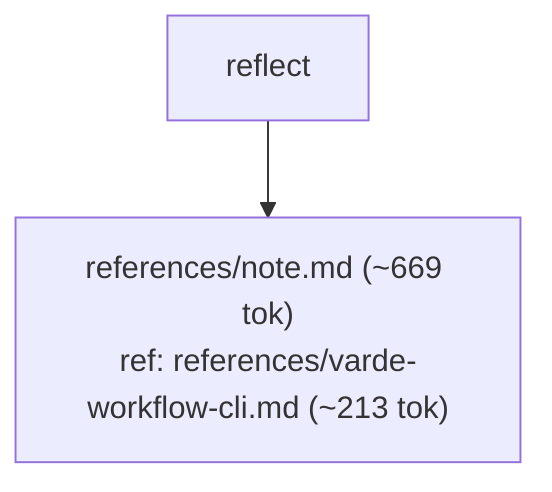
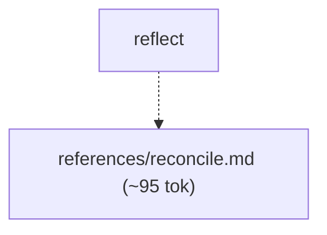
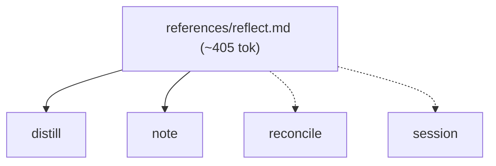
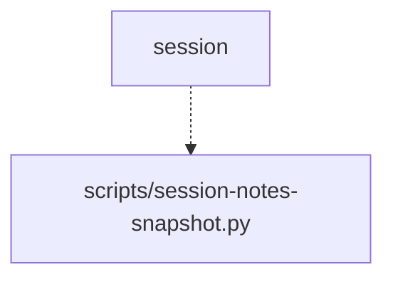
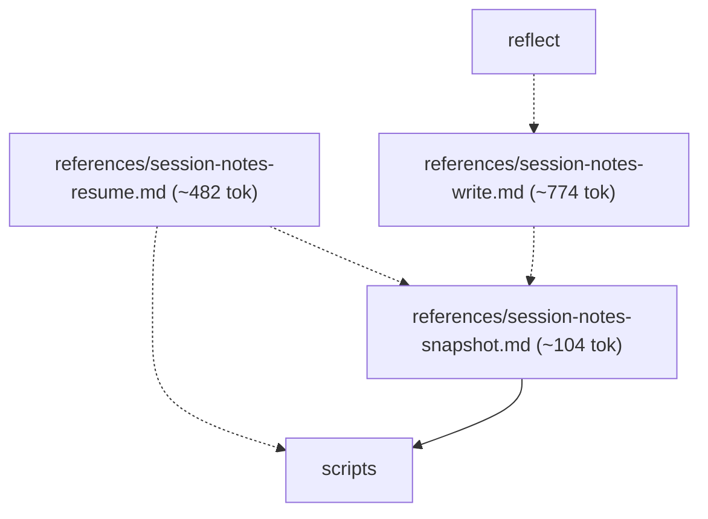

# varde-knowledge flow

Generated for human readers; agents do not load this file. Regenerate
with `varde doc flow --write`. Dotted edges
are conditional loads; min tokens follow only solid edges. Thick edges
are hand-offs to a later stage, outside min and max. Double-bordered
nodes are skill modes run inline or agent dispatches. Min and max count
this skill; main adds modes the main agent runs inline, each file once.
Subagents are per dispatch (multiply by the dispatch count); * marks a
conditional dispatch. Module overview first, then one diagram per module.

## Files

- SKILL.md (~279 tok; routes: Find or record durable knowledge — a decision, pattern, d..., Wrap up finished work or capture what was learned, Distill concluded plans or inactive areas (skip when none..., Write session notes, Resume a session from notes, or pick up where a previous..., Check a knowledge note against current code)
  - references/distill.md (~435 tok; routes: Wrap up finished work or capture what was learned, Distill concluded plans or inactive areas (skip when none...)
  - references/note.md (~669 tok; routes: Find or record durable knowledge — a decision, pattern, d..., Wrap up finished work or capture what was learned)
  - references/reconcile.md (~95 tok; routes: Wrap up finished work or capture what was learned, Check a knowledge note against current code)
  - references/reflect.md (~405 tok; routes: Wrap up finished work or capture what was learned)
  - references/session-notes-resume.md (~482 tok; routes: Resume a session from notes, or pick up where a previous...)
  - references/session-notes-snapshot.md (~104 tok; routes: Wrap up finished work or capture what was learned, Write session notes, Resume a session from notes, or pick up where a previous...)
  - references/session-notes-write.md (~774 tok; routes: Wrap up finished work or capture what was learned, Write session notes)
  - references/varde-workflow-cli.md (~213 tok; routes: Find or record durable knowledge — a decision, pattern, d..., Wrap up finished work or capture what was learned)

### distill

### note

### reconcile

### reflect

### scripts

### session

## Routes

| Route | Min tokens | Max tokens | Main min | Main max | Subagents per dispatch | Lookups | Files |
|---|---|---|---|---|---|---|---|
| Find or record durable knowledge — a decision, pattern, d... | ~948 | ~1161 | ~948 | ~1161 | - | 1 | references/note.md, references/varde-workflow-cli.md |
| Wrap up finished work or capture what was learned | ~1788 | ~2974 | ~1788 | ~2974 | - | 1 | references/reflect.md, references/note.md, references/distill.md, references/session-notes-write.md, references/reconcile.md, references/varde-workflow-cli.md, references/session-notes-snapshot.md, scripts/session-notes-snapshot.py |
| Distill concluded plans or inactive areas (skip when none... | ~714 | ~714 | ~714 | ~714 | - | 0 | references/distill.md |
| Write session notes | ~1053 | ~1157 | ~1053 | ~1157 | - | 0 | references/session-notes-write.md, references/session-notes-snapshot.md, scripts/session-notes-snapshot.py |
| Resume a session from notes, or pick up where a previous... | ~761 | ~865 | ~761 | ~865 | - | 0 | references/session-notes-resume.md, scripts/session-notes-snapshot.py, references/session-notes-snapshot.md |
| Check a knowledge note against current code | ~374 | ~374 | ~374 | ~374 | - | 0 | references/reconcile.md |

## Structure

| Measure | Value | Target | Status |
|---|---|---|---|
| Mutual links | 0 | 0 | ok |
| Max links out of one file | 4 (references/reflect.md) | < 6 | ok |
| Average links per linking file | 1.8 (9 links, 5 files) | <= 2 | ok |
| Cross-module edges | 7 | - | - |
| Diagram edges | 17 | <= 60 | ok |
| Max route cyclomatic | 5 | <= 10 | ok |
| Max route cognitive | 10 | <= 10 warn, <= 15 error | ok |
| Most files reached by one route | 8 (Wrap up finished work or capture what was learned) | <= 15 | ok |

## Findings

- single caller: references/reflect.md <- SKILL.md: Wrap up finished work or capture what was learned
- single caller: references/session-notes-resume.md <- SKILL.md: Resume a session from notes, or pick up where a previous...
- shared: references/distill.md <- SKILL.md: Distill concluded plans or inactive areas (skip when none...; references/reflect.md
- shared: references/note.md <- SKILL.md: Find or record durable knowledge — a decision, pattern, d...; references/reflect.md
- shared: references/reconcile.md <- SKILL.md: Check a knowledge note against current code; references/reflect.md
- shared: references/session-notes-snapshot.md <- references/session-notes-resume.md; references/session-notes-write.md
- shared: references/session-notes-write.md <- SKILL.md: Write session notes; references/reflect.md
