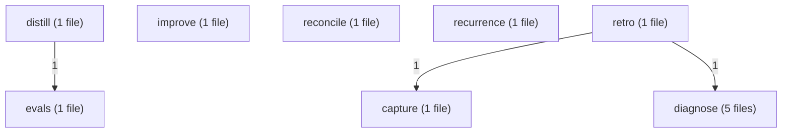
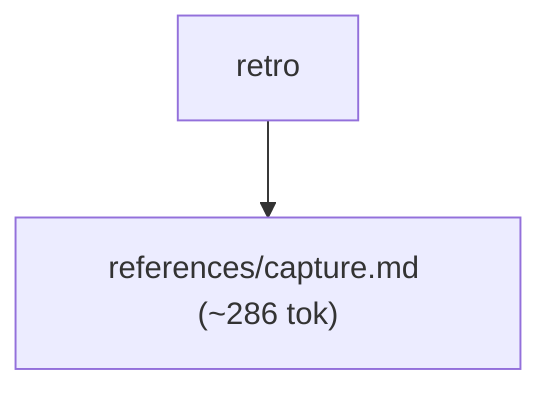
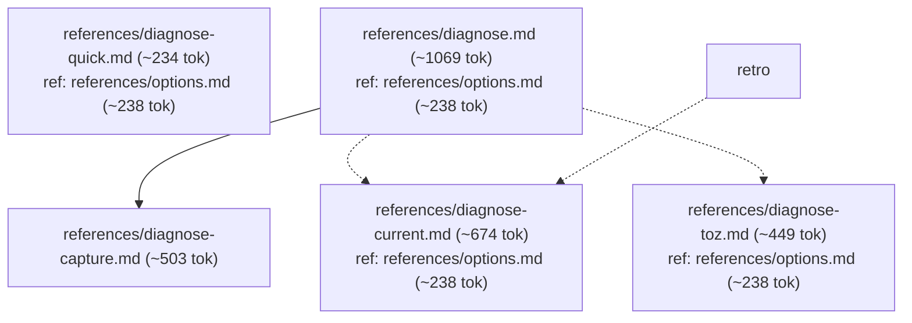
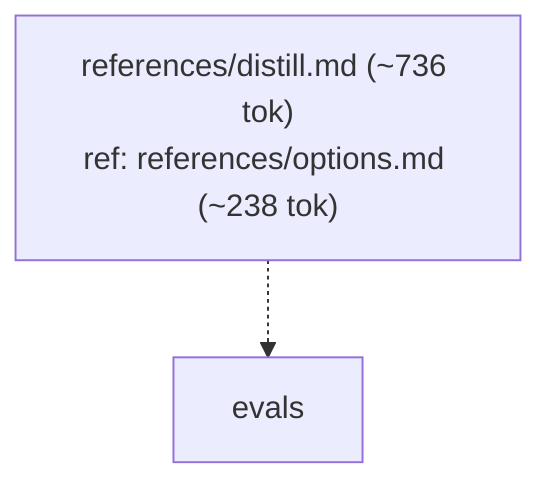
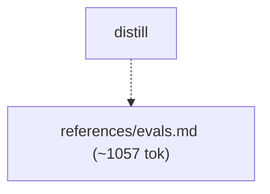
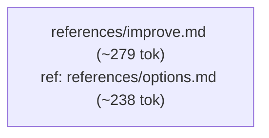
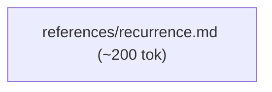
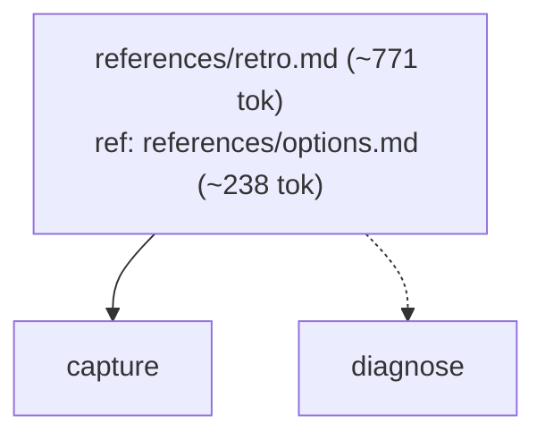

# varde-learn flow

Generated for human readers; agents do not load this file. Regenerate
with `varde doc flow --write`. Dotted edges
are conditional loads; min tokens follow only solid edges. Thick edges
are hand-offs to a later stage, outside min and max. Double-bordered
nodes are skill modes run inline or agent dispatches. Min and max count
this skill; main adds modes the main agent runs inline, each file once.
Subagents are per dispatch (multiply by the dispatch count); * marks a
conditional dispatch. Module overview first, then one diagram per module.

## Files

- SKILL.md (~406 tok; routes: Capture an observed friction event, Triage supplied agent-session evidence without a session-..., Diagnose an existing or current agent session, Run a multi-session retrospective or orchestrated-build w..., Reconcile an item against evidence, Distill recurring friction into an improvement, Check whether an adopted change recurred, Review recurring friction for an improvement proposal, Author query sets or eval cases, or run an approved evalu...)
  - references/capture.md (~286 tok; routes: Capture an observed friction event, Run a multi-session retrospective or orchestrated-build w...)
  - references/diagnose.md (~1069 tok; routes: Diagnose an existing or current agent session)
    - references/diagnose-capture.md (~503 tok; routes: Diagnose an existing or current agent session)
    - references/diagnose-current.md (~674 tok; routes: Diagnose an existing or current agent session, Run a multi-session retrospective or orchestrated-build w...)
    - references/diagnose-quick.md (~234 tok; routes: Triage supplied agent-session evidence without a session-...)
    - references/diagnose-toz.md (~449 tok; routes: Diagnose an existing or current agent session)
  - references/distill.md (~736 tok; routes: Distill recurring friction into an improvement)
  - references/evals.md (~1057 tok; routes: Distill recurring friction into an improvement, Author query sets or eval cases, or run an approved evalu...)
  - references/improve.md (~279 tok; routes: Review recurring friction for an improvement proposal)
  - references/options.md (~238 tok; routes: Triage supplied agent-session evidence without a session-..., Diagnose an existing or current agent session, Run a multi-session retrospective or orchestrated-build w..., Distill recurring friction into an improvement, Review recurring friction for an improvement proposal)
  - references/reconcile.md (~354 tok; routes: Reconcile an item against evidence)
  - references/recurrence.md (~200 tok; routes: Check whether an adopted change recurred)
  - references/retro.md (~771 tok; routes: Run a multi-session retrospective or orchestrated-build w...)

### capture

### diagnose

### distill

### evals

### improve

### reconcile

### recurrence

### retro

## Routes

| Route | Min tokens | Max tokens | Main min | Main max | Subagents per dispatch | Lookups | Files |
|---|---|---|---|---|---|---|---|
| Capture an observed friction event | ~692 | ~692 | ~692 | ~692 | - | 0 | references/capture.md |
| Triage supplied agent-session evidence without a session-... | ~640 | ~878 | ~640 | ~878 | - | 1 | references/diagnose-quick.md, references/options.md |
| Diagnose an existing or current agent session | ~1978 | ~3339 | ~1978 | ~3339 | - | 2 | references/diagnose.md, references/diagnose-current.md, references/diagnose-toz.md, references/options.md, references/diagnose-capture.md |
| Run a multi-session retrospective or orchestrated-build w... | ~1701 | ~2375 | ~1701 | ~2375 | - | 1 | references/retro.md, references/options.md, references/diagnose-current.md, references/capture.md |
| Reconcile an item against evidence | ~760 | ~760 | ~760 | ~760 | - | 0 | references/reconcile.md |
| Distill recurring friction into an improvement | ~1380 | ~2437 | ~1380 | ~2437 | - | 0 | references/distill.md, references/options.md, references/evals.md |
| Check whether an adopted change recurred | ~606 | ~606 | ~606 | ~606 | - | 0 | references/recurrence.md |
| Review recurring friction for an improvement proposal | ~923 | ~923 | ~923 | ~923 | - | 0 | references/improve.md, references/options.md |
| Author query sets or eval cases, or run an approved evalu... | ~1463 | ~1463 | ~1463 | ~1463 | - | 0 | references/evals.md |

## Structure

| Measure | Value | Target | Status |
|---|---|---|---|
| Mutual links | 0 | 0 | ok |
| Max links out of one file | 4 (references/diagnose.md) | < 6 | ok |
| Average links per linking file | 1.86 (13 links, 7 files) | <= 2 | ok |
| Cross-module edges | 10 | - | - |
| Diagram edges | 24 | <= 60 | ok |
| Max route cyclomatic | 4 | <= 10 | ok |
| Max route cognitive | 7 | <= 10 warn, <= 15 error | ok |
| Most files reached by one route | 5 (Diagnose an existing or current agent session) | <= 15 | ok |

## Findings

- chain: references/diagnose-capture.md <- references/diagnose.md
- single caller: references/diagnose-quick.md <- SKILL.md: Triage supplied agent-session evidence without a session-...
- single caller: references/diagnose-toz.md <- references/diagnose.md
- single caller: references/diagnose.md <- SKILL.md: Diagnose an existing or current agent session
- single caller: references/distill.md <- SKILL.md: Distill recurring friction into an improvement
- single caller: references/improve.md <- SKILL.md: Review recurring friction for an improvement proposal
- single caller: references/reconcile.md <- SKILL.md: Reconcile an item against evidence
- single caller: references/recurrence.md <- SKILL.md: Check whether an adopted change recurred
- single caller: references/retro.md <- SKILL.md: Run a multi-session retrospective or orchestrated-build w...
- shared: references/capture.md <- SKILL.md: Capture an observed friction event; references/retro.md
- shared: references/diagnose-current.md <- references/diagnose.md; references/retro.md
- shared: references/evals.md <- SKILL.md: Author query sets or eval cases, or run an approved evalu...; references/distill.md
- shared: references/options.md <- references/diagnose-current.md; references/diagnose-quick.md; references/diagnose-toz.md; references/diagnose.md; references/distill.md; references/improve.md; references/retro.md
