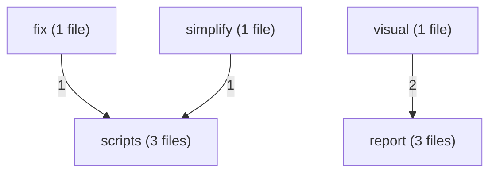
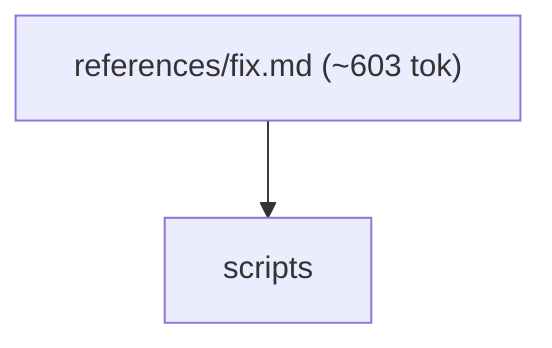
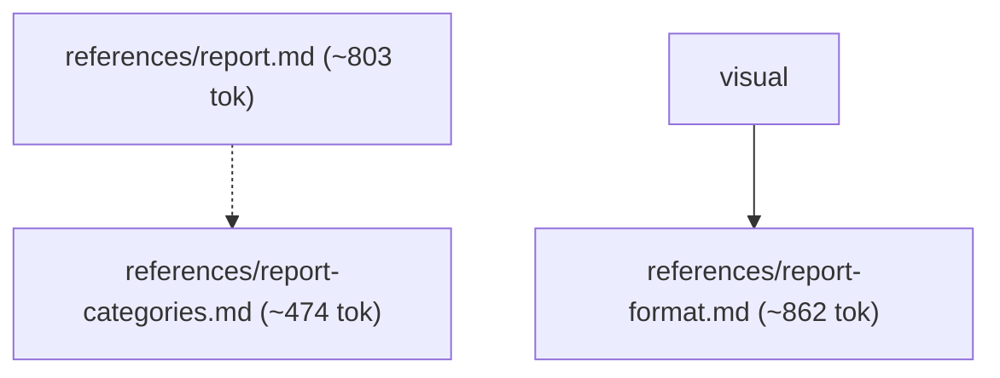
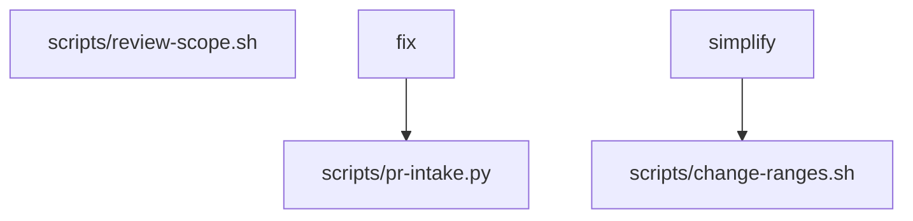
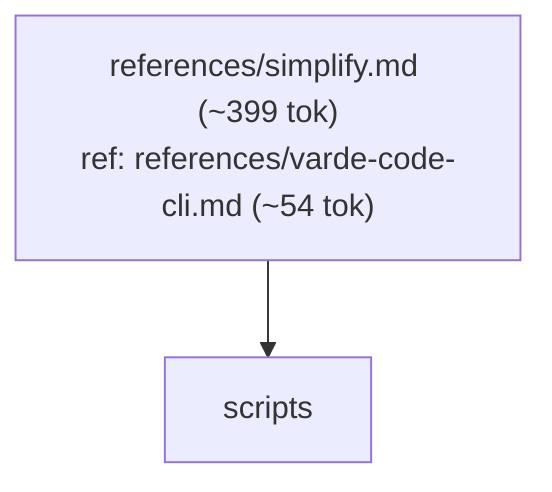
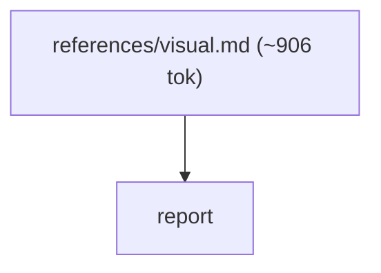

# varde-review flow

Generated for human readers; agents do not load this file. Regenerate
with `varde doc flow --write`. Dotted edges
are conditional loads; min tokens follow only solid edges. Thick edges
are hand-offs to a later stage, outside min and max. Double-bordered
nodes are skill modes run inline or agent dispatches. Min and max count
this skill; main adds modes the main agent runs inline, each file once.
Subagents are per dispatch (multiply by the dispatch count); * marks a
conditional dispatch. Module overview first, then one diagram per module.

## Files

- SKILL.md (~783 tok; routes: Review a diff, branch, or code area and write down what i..., Apply the findings an earlier review already wrote down, Address review threads or failing checks on an open GitHu..., Inspect a running web, iOS simulator, or macOS app visual..., Tidy up a just-committed change — naming, redundancy, con..., Fix one named, already recorded standalone finding)
  - references/fix.md (~603 tok; routes: Apply the findings an earlier review already wrote down, Address review threads or failing checks on an open GitHu..., Fix one named, already recorded standalone finding)
  - references/report.md (~803 tok; routes: Review a diff, branch, or code area and write down what i...)
    - references/report-categories.md (~474 tok; routes: Review a diff, branch, or code area and write down what i...)
    - references/report-format.md (~862 tok; routes: Inspect a running web, iOS simulator, or macOS app visual...)
  - references/simplify.md (~399 tok; routes: Tidy up a just-committed change — naming, redundancy, con...)
  - references/varde-code-cli.md (~54 tok; routes: Tidy up a just-committed change — naming, redundancy, con...)
  - references/visual.md (~906 tok; routes: Inspect a running web, iOS simulator, or macOS app visual...)

### fix

### report

### scripts

### simplify

### visual

## Routes

| Route | Min tokens | Max tokens | Main min | Main max | Subagents per dispatch | Lookups | Files |
|---|---|---|---|---|---|---|---|
| Review a diff, branch, or code area and write down what i... | ~1586 | ~2060 | ~1586 | ~2060 | review* ~1246 | 0 | references/report.md, references/report-categories.md |
| Apply the findings an earlier review already wrote down | ~1386 | ~1386 | ~1386 | ~1386 | review* ~1246 | 0 | references/fix.md, scripts/pr-intake.py |
| Address review threads or failing checks on an open GitHu... | ~1386 | ~1386 | ~1386 | ~1386 | review* ~1246 | 0 | references/fix.md, scripts/pr-intake.py |
| Inspect a running web, iOS simulator, or macOS app visual... | ~2551 | ~2551 | ~2551 | ~2551 | review* ~1246 | 0 | references/visual.md, references/report-format.md |
| Tidy up a just-committed change — naming, redundancy, con... | ~1236 | ~1236 | ~1236 | ~1236 | review* ~1246 | 0 | references/simplify.md, scripts/change-ranges.sh, references/varde-code-cli.md |
| Fix one named, already recorded standalone finding | ~1386 | ~1386 | ~1386 | ~1386 | review* ~1246 | 0 | references/fix.md, scripts/pr-intake.py |

## Structure

| Measure | Value | Target | Status |
|---|---|---|---|
| Mutual links | 0 | 0 | ok |
| Max links out of one file | 2 (references/simplify.md) | < 6 | ok |
| Average links per linking file | 1.25 (5 links, 4 files) | <= 2 | ok |
| Cross-module edges | 4 | - | - |
| Diagram edges | 21 | <= 60 | ok |
| Max route cyclomatic | 5 | <= 10 | ok |
| Max route cognitive | 8 | <= 10 warn, <= 15 error | ok |
| Most files reached by one route | 3 (Tidy up a just-committed change — naming, redundancy, con...) | <= 15 | ok |

## Findings

- chain: references/report-format.md <- references/visual.md
- single caller: references/report-categories.md <- references/report.md
- single caller: references/report.md <- SKILL.md: Review a diff, branch, or code area and write down what i...
- single caller: references/simplify.md <- SKILL.md: Tidy up a just-committed change — naming, redundancy, con...
- single caller: references/visual.md <- SKILL.md: Inspect a running web, iOS simulator, or macOS app visual...
- shared: references/fix.md <- SKILL.md: Address review threads or failing checks on an open GitHu...; SKILL.md: Apply the findings an earlier review already wrote down; SKILL.md: One recorded finding
